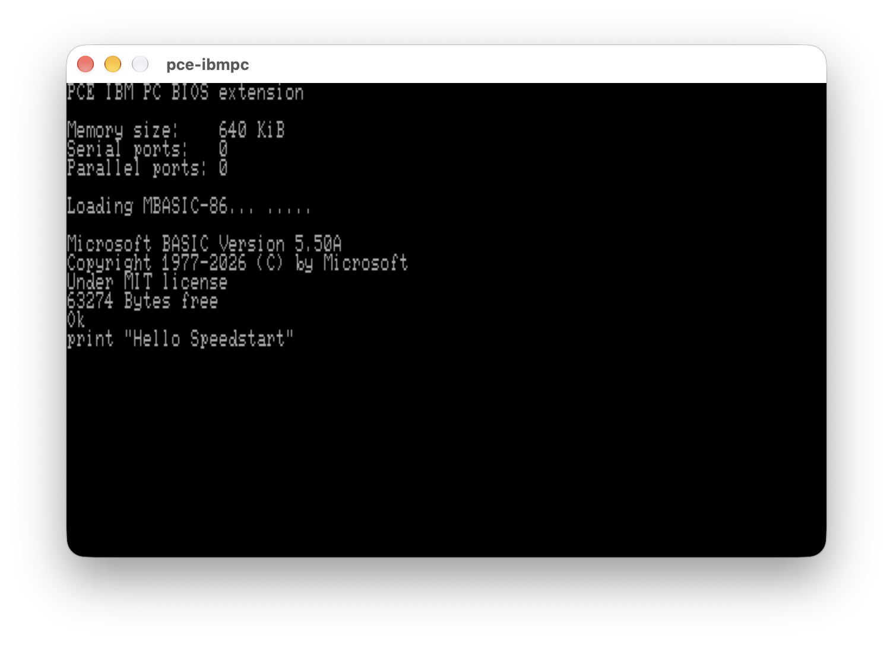

# SpeedStart CP/M-86 — self-booting BASIC

## Synopsis

Recovered from a **1983 IBM PC DR Logo demo**, the SpeedStart boot code and
kernel are rebuilt from complete ASM86 disassemblies to boot the supplied
Microsoft BASIC 5.50A directly on an IBM PC/XT.
No sibling project or original disk image is needed.

This project is **just for historical enjoyment**. For a practical, usable
CP/M-86 system or its multitasking descendants, visit:

| Project | System |
|---|---|
| [cpm86-kernel](https://github.com/tsupplis/cpm86-kernel) | CP/M-86 |
| [ccpm86-kernel](https://github.com/tsupplis/ccpm86-kernel) | Concurrent CP/M-86 |
| [cdos41-kernel](https://github.com/tsupplis/cdos41-kernel) | Concurrent DOS 4.1 |



## Why, history, curiosities

| Topic | Summary |
|---|---|
| Original purpose | SpeedStart packaged CP/M-86 with an application so the disk could boot straight into it. |
| This reference | The supplied 1983 IBM PC DR Logo demo: `SPEED.STR` kernel and `LOGO.STM` application. |
| This project | Recover a reproducible system from source and reuse it for BASIC. Only the startup command and two boot messages change. |
| Hidden loader | Track **0, sector 9** holds a second boot stage, outside the normal eight-sector CP/M filesystem. An ordinary 160 KB copy misses it. |
| Disguised executables | `.STR` and `.STM` retain CMD headers but XOR their code. This is reversible obfuscation. |
| Odd decoder | The boot loader complements **24 KB of memory**, although the stored kernel CODE is only 16,256 bytes. |

Historical context: [John Elliott's CMD/SpeedStart notes](https://seasip.info/Cpm/cmdfile.html).
The implementation details below come from the reconstructed sources.

## Compared with normal CP/M-86

Comparison baseline: the IBM PC CP/M-86 1.1 sources in `cpm86-kernel`.
These are the principal functional differences, not an exhaustive binary diff.

| Part | Normal CP/M-86 | This SpeedStart version |
|---|---|---|
| Boot | Loads `CPM.SYS` | Extra-sector loader reads contiguous `SPEED.STR` at a fixed disk position and decodes it |
| CCP | Command shell; loads `.CMD` programs | Preloaded `A:LOGO` command, changed here to `A:MBASIC86`; searches for `.STM` |
| BDOS | Console, file and memory services; ordinary CMD loading | Same service model; program loader additionally XORs the **first group** with `A5B4h` |
| BIOS | IBM PC hardware services and system initialization | Same jump-vector interface; its own Logo-era initialization, messages and disk configuration |
| Packaging | General-purpose operating-system disk | Application-first disk; kernel CODE is complemented on disk |

The familiar CCP / BDOS / BIOS split remains. BASIC's successful disk
SAVE/LOAD test demonstrates that CP/M file services still operate underneath.

## Build and run

Needs `make`, Python 3 and `cpm86_asm86`; checks also need PCE's `psi`.

```sh
make                 # stm-basic.imd, stm-basic.img, msbasic.stm
make check           # original byte identity, encoding and disk layout
make check-live      # PCE: boot, 6*7=42, SAVE/NEW/LOAD/RUN=80235
./stm                # interactive PCE, private retained disk copy
make clean           # remove generated outputs
```

Use **`stm-basic.imd`** in PCE. The launcher requires `pce-ibmpc` and
`ibm-xt-1982-11-08.rom`, `ibm-basic-1.10.rom`, `ibmpc-pcex.rom`.
Set `PCE_ROM_DIR=/path/to/roms ./stm`; for tests, use
`make check-live ROM_DIR=/path/to/roms`. Defaults: local `rom/`, then
`$HOME/.local.darwin/emulators/share/pce/ibmpc`. F12 is PCE's escape key.

## Layout

| Location | Contents |
|---|---|
| `base/` | Original boot sectors, `speed.str`, supplied `msbasic.cmd`; no `.stm` or disk images |
| `kernel/` | Complete boot, loader, header, CCP, BDOS and BIOS sources; BASIC overlays; Makefile |
| `tools/` | Python assembly joining, encoding, image creation and checks |
| Root | Top Makefile, generated images, `stm` / `stm.cfg`, README and licences |

The reference build reproduces both boot sectors and `SPEED.STR` byte-for-byte;
no opaque kernel binary regions are copied into the build.

## Image structure

40 tracks, one side, 512-byte sectors; eight sectors per track, **nine on track 0**.

| Location | Contents |
|---|---|
| Track 0, sector 1 | Boot sector → `0000:7C00` |
| Track 0, sector 9 | Extra loader → `0000:7800` |
| Track 1, sectors 1–4 | 2 KB directory; `SPEED.STR` must be first |
| Allocation blocks 2–17 | Contiguous 16 KB kernel; moving it breaks booting |
| Blocks 18–52 | `MBASIC86.STM`; 103 KB remains free |

`tools/image.py` creates the filesystem and both images. IMD preserves all
321 physical sectors. Raw IMG is 184,320 bytes: nine slots per track, including
39 synthetic sectors. It is **not** a conventional 160 KB CP/M image.

## Encoding and kernel map

Host encoder: **`tools/encode.py::transform()`**. Both XOR operations are their
own inverse; the 128-byte CMD header and non-CODE groups remain unchanged.

| File | CODE encoding | Guest decoder |
|---|---|---|
| `SPEED.STR` | Byte XOR `FFh` | `kernel/loader.a86`: `complement_kernel` |
| `MBASIC86.STM` | Word XOR `A5B4h` (bytes `B4h,A5h`) | `kernel/bdos.a86`: `copy_paragraph` / `copy_word` |

The guest decodes descriptor zero: applications must have **CODE first**.
Example: `python3 tools/encode.py application base/msbasic.cmd /tmp/basic.stm`.

| Module | CODE offsets, end exclusive | Notable location |
|---|---|---|
| CCP | `0000h–0A00h` | Startup buffer `0009h`; extension `0800h` |
| BDOS | `0A00h–2500h` | INT E0h entry `0B06h`; STM decoder `0E8Eh` |
| BIOS | `2500h–3F80h` | Vectors `2500h`; cold initialization `3757h` |

CODE loads at segment `0051h`. `kernel/speed.*` preserves the original;
`kernel/basic.*` applies `basccp.a86`. `basboot.a86` and `basload.a86` replace
only boot messages. The loader remains tied to this disk geometry.

Original Digital Research licence files are retained; third-party application
and ROM rights are separate.

---

## Companion projects

| Project | Description |
|---------|-------------|
| [cpm86-kernel](https://github.com/tsupplis/cpm86-kernel)     | CP/M-86 1.1 distribution rebuilt from patched and reconstituted sources |
| [ccpm86-kernel](https://github.com/tsupplis/ccpm86-kernel)         | CCP/M-86 3.1 distribution rebuilt from patched and reconstituted sources |
| [cdos41-kernel](https://github.com/tsupplis/cdos41-kernel)         | Concurrent DOS 4.1 distribution rebuilt from patched and reconstituted sources |
| [cpm86-crossdev](https://github.com/tsupplis/cpm86-crossdev) | Unix CP/M-86 cross development project (compilers, emulation and tools) |
| [cpm86-hacking](https://github.com/tsupplis/cpm86-hacking)   | CP/M-86 miscellaneous tools and PCE emulator helpers |
| [cpm86-cmdtools](https://github.com/tsupplis/cpm86-cmdtools) | CP/M-86 `.cmd` file manipulation tools |
| [cpm86-ports](https://github.com/tsupplis/cpm86-ports)       | CP/M-86 application ports in C and assembler |
| [cpm86-vi](https://github.com/tsupplis/cpm86-vi)             | STevie vi port for CP/M-86 and PC-DOS |
| [cpm86-msbasic](https://github.com/tsupplis/cpm86-msbasic)   | A recreaction of msbasic-86 for CP/M-86 and PC-DOS 1.1 from gwbasic sources |
| [cpm86-menu](https://github.com/tsupplis/cpm86-menu)   | A submit replacement and a menu system for submit orchestration for CP/M-86 1.1 |
| [cpm86-make](https://github.com/tsupplis/cpm86-make)   | A simple submit based make tool for CP/M-86 |
| [pcdos11-hacking](https://github.com/tsupplis/pcdos11-hacking) | PC-DOS 1.1 distribution, tools and notes |

---

## License

CP/M-derived material is covered by the [CP/M license](LICENSE.md); other materi